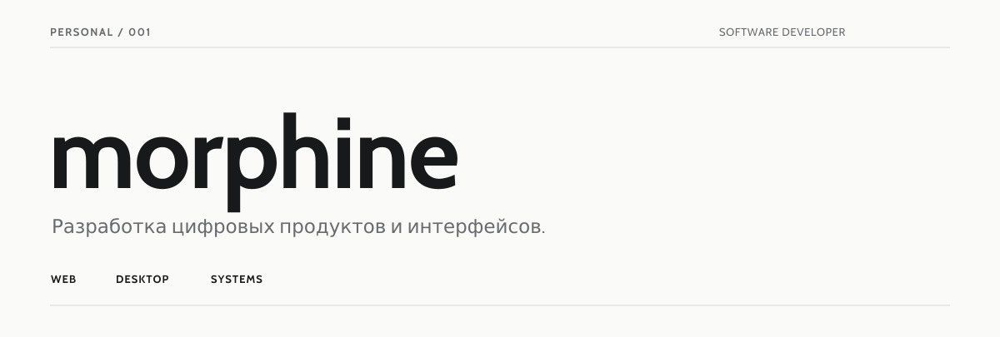
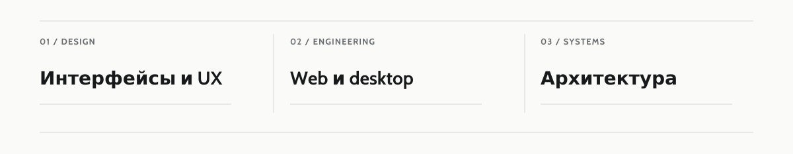
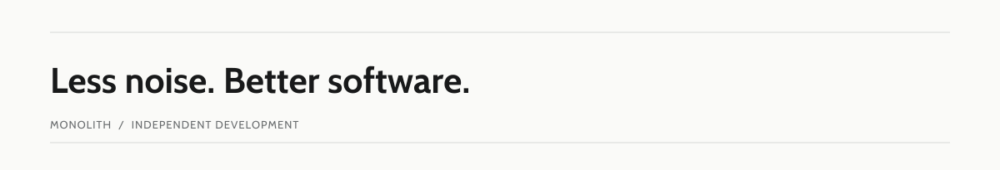

<picture>
  <source media="(prefers-color-scheme: dark)" srcset="./assets/hero-dark.svg">
  
</picture>

 

<picture>
  <source media="(prefers-color-scheme: dark)" srcset="./assets/focus-dark.svg">
  
</picture>

### Обо мне

Разрабатываю веб- и desktop-приложения. Ценю продуманные интерфейсы, ясную архитектуру и качество реализации.

`TypeScript` · `React` · `Node.js` · `Rust` · `Tauri` · `PostgreSQL`

 

<picture>
  <source media="(prefers-color-scheme: dark)" srcset="./assets/closing-dark.svg">
  
</picture>
